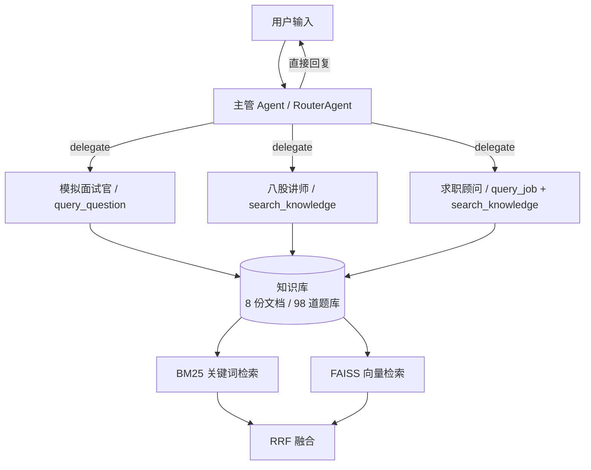

# AI 面试智能系统

面向「大模型 / AI 应用开发」第一次实习的**多 Agent + RAG 面试陪练应用**。绑定个人档案与目标 JD，自动生成专属面试官，覆盖**面试前设计 → 面试中陪练 → 面试后评分**的完整闭环。

它不是通用聊天机器人：面试官会围绕你的真实项目与岗位要求深挖追问，结束后给出评分标准驱动的结构化报告与补强计划。

## 它解决了什么

| 痛点 | 解法 |
| --- | --- |
| 没人陪练、练习没反馈 | 主管 Agent 路由 + 模拟面试官 / 八股讲师 / 求职顾问三个专员协作，Function Calling 驱动真实工具调用 |
| 复习没重点、八股全靠背 | RAG 知识库（8 份文档 / 98 道题库）提供有依据的讲解，检索质量可用 Recall@K / MRR 量化 |
| 面试必问项目，但不会讲 | 「我的档案」绑定真实项目，面试自动插入约 30% 项目深挖题（技术选型 / 难点 / 量化 / 失败与改进） |
| 练了没进步、复盘靠感觉 | rubric 驱动的整场评分（能力分 0–5）+ 学习教练生成补强计划 + 历史对比 |

## 面试闭环

- **prep 面试前**：粘贴目标 JD → 解析岗位画像（必须项 / 加分项 / 职责 / 技术栈）→ 与个人档案做差距分析 → 生成完整问题计划（难度曲线 1–5、考察能力、评分标准 rubric、追问种子）
- **live 面试中**：面试官按 rubric 逐题点评并给出 0–5 分，追问方向提前可见
- **post 面试后**：逐题评分 → 能力分聚合 → 最弱题的改进参考答案 → 学习教练生成补强模块

## 技术栈

- **后端**：FastAPI · SQLite（SQLAlchemy 2.x）· Pydantic
- **前端**：React 18 · TypeScript · Vite
- **大模型**：DeepSeek（OpenAI 兼容接口），支持流式输出
- **检索**：jieba 分词 + **BM25** 关键词检索；可选 **FAISS + m3e 向量检索**，双路 **RRF** 融合
- **工程化**：pytest（23 项）· GitHub Actions CI

## 架构



**分层设计**：主管只负责意图路由（单次 LLM 调用，不生成业务答案）；三个专员各自持有独立的系统提示词与工具子集；所有步骤写入统一轨迹（trace）供前端展示。

## 快速开始

```bash
# 1. 依赖
python -m venv .venv && source .venv/bin/activate
pip install -r requirements.txt

# 2. 配置（复制后填入 DEEPSEEK_API_KEY）
cp .env.example .env

# 3. 启动（后端 8001 + 前端）
./start.command
```

可选：启用向量检索（体积较大，按需安装）

```bash
pip install -r requirements-rag.txt   # faiss-cpu + sentence-transformers
```

未安装时自动降级为纯 BM25 关键词检索，功能不受影响。

## 核心设计

### 1. 手写 Function Calling 循环，不依赖 LangGraph

`backend/app/agent/loop.py` 实现了完整的工具调用循环，包含**流式场景下的 tool_calls 分片拼装**：流式返回时工具参数分片到达，需按 `index` 聚合、按 `id` 归并后才能执行。同步与流式两条路径共用同一套工具执行与轨迹记录逻辑。

选择手写而非直接用 LangGraph，是为了彻底搞清 FC 的底层机制（消息序列构造、tool_calls 解析、结果回填、循环终止条件）。

### 2. 混合检索与 RRF

`backend/app/agent/rag.py`：

- **分块**：按 Markdown 标题感知切分；过长小节再切成带重叠的窗口，避免边界上下文丢失
- **关键词召回**：BM25（含 IDF 与文档长度归一化），而非原始词频计数
- **向量召回**：m3e-base 编码 + FAISS 内积索引；索引持久化，文档指纹变更后自动重建
- **融合**：RRF（Reciprocal Rank Fusion，k=60）合并双路排名，无需归一化不同量纲的分数

### 3. 消息序列安全截断

`backend/app/agent/memory.py`：大模型 API 要求「tool 消息必须紧跟带 tool_calls 的 assistant 消息」「每个 tool_call_id 都要有响应」。按条数硬截断会破坏这两种配对并导致 400 错误，因此在出参前统一做一次安全修剪。

## 评测

所有指标可用脚本复现，**口径写在脚本头部**。

### RAG 检索（`python scripts/eval_rag.py`）

命中粒度为**文档级**（期望文档出现在 Top-3 即算命中）：

| 评测组 | 题量 | Recall@3 | MRR |
| --- | --- | --- | --- |
| A 术语型（复用文档术语） | 71 | 1.000 | 0.951 |
| B 改述型（不复用文档术语） | 10 | 0.900 | 0.667 |

**怎么读这组数**：A 组接近满分说明知识库主题区分度好，但题目复用了文档术语，属于**偏容易的基线**；B 组刻意改述后指标明显下降，恰好说明**纯关键词检索无法处理语义改写**——这也是接入向量检索的动机。默认环境下未安装 FAISS，实际运行在纯 BM25 模式。

### 多 Agent 路由（`python scripts/eval_agent.py`）

50 道题覆盖 4 类意图（面试官 / 讲师 / 顾问 / 直接回复），输出路由准确率、工具准确率、回答完整率。该脚本会真实调用大模型 API。

## 测试

```bash
pytest tests/ -q      # 23 项：路由与专员协作、记忆回填、RAG 分块与检索、档案与复盘存储
```

## 目录结构

```
backend/app/
  agent/
    loop.py         Function Calling 循环（同步 + 流式）
    harness.py      多 Agent 编排：主管路由 + 专员
    roles.py        各角色提示词与工具子集
    rag.py          分块 + BM25 + 向量 + RRF
    memory.py       会话记忆与安全截断
  db.py             SQLAlchemy 模型
  interview.py      面试闭环（prep / live / post）
  profile.py        个人档案与 JD 解析
server/
  main.py           FastAPI 接口与 SSE 流式
data/
  knowledge/        8 份知识库文档
  questions.json    98 道题库
scripts/
  eval_rag.py       RAG 检索评测
  eval_agent.py     多 Agent 路由评测
web/                React + TypeScript 前端
```

## 设计参考

架构参考了 [DeepInterview](https://github.com/ngoanpv/DeepInterview)（Apache-2.0）的 prep/live/post 三段式与 rubric 评分、[聆悟 ai-interview-platform](https://github.com/yuanzhongqiao/ai-interview-platform)（MIT）的自然语言面试设计。代码为本项目重写实现。

## License

MIT
